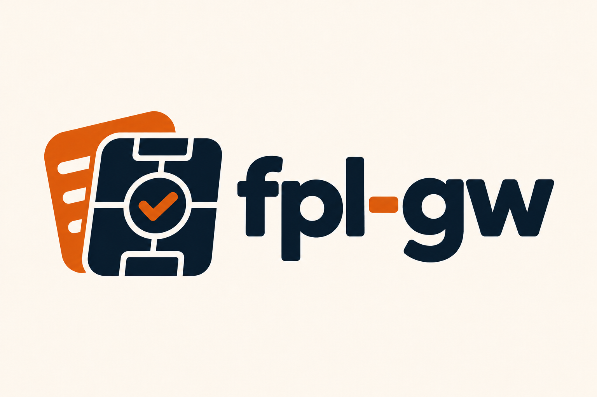

<p align="center">
  
</p>
<h1 align="center">fpl-gw</h1>
<p align="center"><strong>Plan your gameweek. Keep the decisions that matter.</strong></p>
<p align="center">FPL AI Assistant — Skill สำหรับ AI harness ที่รองรับ Skills<br>เช็กข่าว · เทียบ transfers · เลือก captain · ประเมิน xPts<br><strong>เริ่มในแชตได้ทันที — ไม่ต้องมี Obsidian หรือ workspace</strong></p>
<p align="center">
  <a href="#เริ่มใช้งาน">เริ่มใช้งาน</a> · <a href="#ลองถามแบบนี้">ตัวอย่างคำถาม</a> · <a href="#workspace-mode-เก็บประวัติเป็นตัวเลือก">เก็บประวัติ</a> · <a href="#scripts">Scripts</a> · <a href="#ข้อจำกัดที่ควรรู้">ข้อจำกัด</a>
</p>

---

ส่ง screenshot ทีม หรือบอกชื่อผู้เล่นที่อยากเทียบ แล้วให้ `fpl-gw` ช่วยวิเคราะห์ข่าว, transfers, captain และคะแนนคาดการณ์ได้เลย หากอยากเก็บแผนกับบทเรียนต่อเนื่อง ค่อยเปิด Workspace mode เพื่อบันทึกเป็นไฟล์ Markdown

| | Quick mode — ค่าเริ่มต้น | Workspace mode — เลือกใช้ |
|---|---|---|
| เริ่มต้น | ส่งทีม/รายชื่อผู้เล่นในแชต | สร้างหรือเลือกโฟลเดอร์ Markdown |
| ข้อมูลทีม | Screenshot หรือข้อความ | `Squad.md` และข้อมูลที่ส่งเพิ่ม |
| การวิเคราะห์ | ข่าว, transfers, captain, matchup, xPts | เหมือน Quick mode พร้อมอ่านประวัติ |
| การเก็บแผน | อยู่ในแชต ไม่มีไฟล์ประวัติข้ามแชต | โน้ตราย GW, season log และ lessons |
| Obsidian | ไม่ต้องมี | ไม่ต้องมี; ใช้เพิ่มสำหรับ dashboard ได้ |

> **คุณเป็นคนตัดสินใจและทำรายการใน FPL เอง** การยืนยันหรือบันทึกแผนไม่ได้ซื้อขาย เปลี่ยน XI หรือเลือก captain ในบัญชี FPL

## เริ่มใช้งาน

ใช้กับ AI harness ที่โหลด Skills และอ่านไฟล์ได้ เช่น Claude Code, Codex หรือ OpenCode โดยเลือกวิธีเพิ่ม skill ตาม harness ที่ใช้ ไม่ต้องมี plugin system เฉพาะค่าย

สำหรับ scripts ต้องมี **Node.js 18+**, สิทธิ์เรียกคำสั่ง และ network access — ใช้เฉพาะ Node built-ins ไม่ต้องรัน `npm install` การเก็บ workspace ต้องมีสิทธิ์เขียนไฟล์ ส่วน web search/browser เป็นตัวเลือกสำหรับข่าวและข้อมูลเพิ่มเติม หากไม่มีเครื่องมือบางอย่าง agent ต้องแจ้งข้อจำกัดและใช้เฉพาะหลักฐานที่เข้าถึงได้

### 1. เพิ่ม Skill ให้ harness ที่ใช้

1. ดาวน์โหลด [portable skill v0.2.1](https://github.com/encryptedarc/fpl/releases/download/v0.2.1/fpl-gw-v0.2.1.zip) แล้วแตก ZIP หรือ clone repo นี้
2. คัดลอกโฟลเดอร์ [fpl-gw](plugins/fpl-gw/skills/fpl-gw/) **ทั้งโฟลเดอร์** ไปยัง skills directory ที่ harness ของคุณกำหนด หรือใช้วิธี import skill ที่ harness รองรับ
3. เก็บ `SKILL.md`, `scripts/`, `references/` และ `assets/` ไว้ด้วยกัน แล้วโหลด skill ตามวิธีของ harness นั้น

ไม่จำเป็นต้องติดตั้ง Claude Code plugin เพื่อใช้ core skill หาก harness ไม่ค้นพบ skill อัตโนมัติ ให้ระบุ path ของ `SKILL.md` และให้ agent อ่านพร้อม resources ที่เกี่ยวข้อง

### 2. ส่งทีม แล้วถามได้เลย

```text
นี่คือทีมของฉัน [แนบ screenshot หน้า Pick Team]
ช่วย check ข่าวก่อน deadline และแนะนำ C/V ให้หน่อย
```

หรือเริ่มจากคำถามสั้น ๆ เช่น **“เทียบ Saka กับ Palmer ให้หน่อย”** โดยไม่ต้องส่งทั้งทีม Agent จะถามเฉพาะข้อมูลที่จำเป็น เช่น selling price หรือ ITB หากต้องตรวจงบ

**Quick mode ไม่ต้อง initialize workspace และไม่ต้องมีไฟล์กฎหรือ `Squad.md`** ไม่มีการสร้างโน้ตอัตโนมัติ; scripts ยังใช้ cache API ใน OS temp ได้ หากเริ่มแชตใหม่ให้ส่งทีมและแผนล่าสุดอีกครั้ง หรือเลือกใช้ Workspace mode ด้านล่าง

### Optional: Claude Code plugin adapter

เฉพาะผู้ที่ใช้ Claude Code สามารถติดตั้ง wrapper นี้แทนการคัดลอก skill เอง:

```text
/plugin marketplace add encryptedarc/fpl
/plugin install fpl-gw@fpl
```

โหลด plugin ใหม่ตามวิธีของ Claude Code อัปเดต marketplace ด้วย `/plugin marketplace update fpl` คำสั่ง `/fpl-gw:init` และตัวแปร `CLAUDE_PLUGIN_ROOT` เป็นของ adapter นี้เท่านั้น ไม่ใช่ requirement ของ core skill

## ลองถามแบบนี้

| งาน | ตัวอย่างคำถาม | สิ่งที่ได้ |
|---|---|---|
| Team news | “check ข่าวก่อน deadline” | เวลาที่เหลือ, status ผู้เล่น, ข่าวบาดเจ็บ, ราคาและ transfers |
| Transfers | “เทียบสองคนนี้ ซื้อใครดี” | สถิติ, minutes, fixtures/FDR และงบที่แต่ละทางเลือกต้องใช้ |
| Captain | “GW นี้ C ใคร และ V ใครดี” | เทียบตัวเลือก, คู่แข่ง, xPts และกรณีได้ลงตัวจริง |
| Matchup | “คู่แข่งเกมรับเป็นยังไง” | ผลล่าสุด, xGF/xGA และ home/away split |
| Projection | “คาดการณ์คะแนน XI พร้อม bench” | xPts รายคนและช่วงคะแนนจาก Monte Carlo เมื่อระบุ simulation |
| Lock | “ยืนยันแผนนี้” | สรุปแผนในแชต; บันทึกลงไฟล์เมื่อใช้ Workspace mode |
| Review | “นี่คือผลแต้ม ช่วย review ให้หน่อย” | วิเคราะห์ผลในแชต; อัปเดต season log และ lessons เมื่อใช้ Workspace mode |

ตัวเลขที่ agent ประเมินต้องติดป้าย `(est.)` แยกจากผลจริง และตัวเลขจากเว็บต้องมีแหล่งพร้อมวันที่

## Workspace mode: เก็บประวัติเป็นตัวเลือก

อยากให้แชตถัดไปอ่านทีม แผนและเหตุผลเดิมได้ ให้สร้าง workspace ในโฟลเดอร์ธรรมดา:

```text
node "<skill-dir>/scripts/init-vault.js" --dir "/path/to/FPL" --season 2026-27
```

แทน `<skill-dir>` ด้วย path ของโฟลเดอร์ fpl-gw ที่ติดตั้งไว้ ผู้ใช้ Claude Code adapter จะใช้ `/fpl-gw:init <folder> 2026-27` แทนได้

บน Windows ใช้ absolute path ได้ หากมีช่องว่างให้ครอบด้วย quotes ตัว scaffold เก็บไฟล์เดิมไว้โดยไม่เขียนทับ จากนั้นส่ง screenshot ให้ agent กรอก `Squad.md` และแจ้งภาษาที่ต้องการใน `AGENTS.md` §1 ข้อ 8; FPL team ID เป็นตัวเลือก

เปิด AI harness ใน workspace หรือระบุ path ให้ agent หรือกำหนด `FPL_WORKSPACE` เป็น path ของโฟลเดอร์ สำหรับ scripts ใช้ `--workspace "<path>"` ได้ โดย `--vault` และ `FPL_VAULT` ยังรองรับของเดิม ไม่ต้องย้ายไฟล์หรือสร้าง workspace ใหม่; กฎเดิมใน `CLAUDE.md` ยังรองรับ และ initializer ไม่เขียนทับไฟล์เดิม

### Workflow รายสัปดาห์

**Plan → Refine → Lock → Close**

| ขั้นตอน | เมื่อไร | บันทึกอะไร |
|---|---|---|
| **Plan** | เริ่มวางแผน GW ใหม่ | สร้าง `GW/GWnn.md` จาก template สถานะ `planning` |
| **Refine** | มีข่าวหรือเปลี่ยนทางเลือก | เพิ่ม Team news และ Decision path โดยเก็บเหตุผลเดิม |
| **Lock** | ผู้ใช้ยืนยันแผน | สถานะ `locked`, กรอกแผนและอัปเดต `Squad.md` |
| **Close** | มีหลักฐานผลคะแนน | สถานะ `closed`, บันทึกผล, อัปเดต season และ lessons |

ข้อมูลที่ไม่มีหลักฐานใช้ `unknown` และการแก้ผล GW ที่ปิดแล้วต้องมีหลักฐานใหม่พร้อมบันทึก correction ตามกฎ workspace

### ภายใน workspace

```text
FPL/
├── AGENTS.md                 # กฎกลาง, schema และลำดับการอ่าน
├── CLAUDE.md                 # compatibility pointer สำหรับบาง harness
├── README.md                 # คู่มือของ workspace
├── Squad.md                  # ทีมปัจจุบัน, ITB และ watchlist
├── Lessons.md                # Checklist และบทเรียน
├── Season 2026-27.md          # Dashboard, GW log, chips และ captain record
├── Fixtures 2026-27.md        # Fixtures และ FDR
├── GW/                       # โน้ตแยกตาม Gameweek
└── Templates/GW Template.md
```

เมื่อใช้ Workspace mode scripts อ่านตาราง `Squad.md` ตามคอลัมน์ **Pos | Player | Club** ให้เก็บลำดับนี้ไว้ ใช้ชื่อผู้เล่นตาม FPL และรหัสสโมสร เช่น `ARS` หรือ `LIV` **Obsidian / Dataview เป็น Optional integration:** ใช้เฉพาะตาราง dashboard อัตโนมัติ ส่วน GW log และ captain record เป็นตาราง Markdown ที่เปิดด้วย editor ทั่วไปได้

## Scripts

ตัวอย่างนี้รันจาก **root ของ repo** ใช้ Quick mode โดยไม่ต้องมี workspace ชื่อผู้เล่นต้องตรงกับ API ของ season ที่ใช้อยู่ เมื่อติดตั้ง skill แยก ให้ agent resolve scripts จากโฟลเดอร์ skill และเรียกด้วย absolute path

```bash
# ข่าวของผู้เล่นที่ระบุโดยตรง
node plugins/fpl-gw/skills/fpl-gw/scripts/news.js --players "Saka:ARS,Palmer:CHE"

# เทียบผู้เล่นและ fixtures ถัดไป
node plugins/fpl-gw/skills/fpl-gw/scripts/compare.js --players "Saka:ARS,Palmer:CHE" --n 6

# สถิติคู่แข่งจากผล 5 นัดล่าสุด
node plugins/fpl-gw/skills/fpl-gw/scripts/opponent.js --teams ARS,CHE --last 5

# Projection รายคน ไม่ต้องมี Squad.md
node plugins/fpl-gw/skills/fpl-gw/scripts/projection.js --players "Saka:ARS,Palmer:CHE" --gw 11

# Optional: สร้าง workspace เพื่อเก็บประวัติ
node plugins/fpl-gw/skills/fpl-gw/scripts/init-vault.js --dir "/path/to/FPL" --season 2026-27
```

สำหรับ projection ของ XI ให้เพิ่ม `--xi` เป็นชื่อ 11 คน, `--bench` เป็น GK สำรองตามด้วยผู้เล่นสำรองตามลำดับ, `--captain`, `--vice` และ `--sims 20000` เมื่อระบุ `--xi` scripts จะสร้าง player pool จาก XI และ bench โดยไม่อ่าน `Squad.md`; ใช้ `Name:CLUB` เพื่อแยกชื่อซ้ำ และเพิ่มเป้าหมายด้วย `--extra`

| Flag | ใช้กับ | ความหมาย |
|---|---|---|
| `--players "A:CLUB,B:CLUB"` | News / projection | ระบุ player pool โดยตรง แทนการอ่าน squad จาก workspace |
| `--extra "Name:CLUB"` | News / projection | เพิ่มผู้เล่นเข้ากับ pool ที่เลือกหรือ squad ที่อ่านจาก workspace |
| `--workspace <dir>` | News / projection | อ่าน squad จากโฟลเดอร์; รองรับชื่อเดิม `--vault` |
| `--cache <dir>` | Data scripts | ตำแหน่ง cache; default คือ `fpl-cache` ใน OS temp |
| `--fresh` | Data scripts | ดึงข้อมูลใหม่ ยกเว้น live data ของ GW ที่จบแล้ว |
| `--gws 11-13` | Projection | แสดงหลาย GW พร้อมผลรวมรายคน |
| `--if-starts "Name"` | Projection | เพิ่มคอลัมน์ประเมินเมื่อได้ลงตัวจริง |
| `--minutes "Name:0"` | Projection | จำลองสถานการณ์โดยกำหนด minutes ของผู้เล่น |

ลำดับ path สำหรับอ่าน squad คือ `--workspace` → `--vault` → `FPL_WORKSPACE` → `FPL_VAULT` → โฟลเดอร์ปัจจุบัน โดย `--players` หรือ `--xi` ของ projection มีสิทธิ์เหนือ squad ที่บันทึกไว้ Quick mode ของ agent จะส่งผู้เล่นโดยตรงเพื่อไม่อ่านทีมจากโฟลเดอร์อื่นโดยไม่ตั้งใจ

**สำหรับผู้ใช้เดิม:** `news.js --players` เปลี่ยนเป็นเลือกเฉพาะรายชื่อที่ระบุ หากต้องการเช็ก squad ใน workspace พร้อม targets ให้ใช้ `--workspace "<path>" --extra "Name:CLUB"`

ดูวิธีใช้เพิ่มเติมใน [SKILL.md](plugins/fpl-gw/skills/fpl-gw/SKILL.md) และ [projection reference](plugins/fpl-gw/skills/fpl-gw/references/projection.md)

## ข้อมูลและโมเดล

**FPL API** เป็นแหล่งหลักสำหรับ players, fixtures, status, live points และสถิติ ส่วน press conference และ predicted lineups ต้องใช้ web tools ของ agent เพิ่มเติม หาก session มี browser จึงอาจใช้ข้อมูล matchup จาก xGstat ได้

Projection ใช้ team xG ที่รวมจากข้อมูลผู้เล่นใน FPL live API เพื่อประเมินโอกาสทำประตู/เสียประตู ปรับ home/away ±8% แล้วคำนวณจาก xG/90, xA/90 และ minutes ย้อนหลัง โมเดลรวม appearance, goals, assists, clean sheets, goals conceded, saves, defensive contribution และ bonus

Monte Carlo สุ่ม minutes, goals และ assists รวมถึง goals conceded ร่วมกันในระดับทีม พร้อม logic auto-sub และ vice-captain ผลเป็น **estimate เพื่อเทียบทางเลือก** ยังไม่มีผล calibration หรือ backtest ใน repo นี้

## ข้อจำกัดที่ควรรู้

- **Double Gameweek ยังไม่รองรับใน projection** ตารางแสดง `DGW — not modelled` เป็น 0 และ simulation อาจหยุดทำงาน ห้ามตีความเป็นคะแนนคาดการณ์จริง
- **Fixture ที่ยังไม่มี kickoff time** อาจทำให้ `news.js` หยุดทำงาน
- **เวลา `fetched` ใน output เป็นเวลารัน** เมื่ออ่าน cache อาจไม่ใช่เวลาที่ดึงข้อมูลจริง ใช้ `--fresh` เมื่อต้องการข่าวล่าสุด และตรวจ timestamp ของ cache หากต้องการ audit
- **ยังไม่จำลอง** cards, own goals, penalty saves, form trends หรือ chip multipliers; auto-subs อยู่ใน simulation เท่านั้น
- **เวลา fixtures ใน `news.js` เป็น TH (UTC+7)** แม้รันเครื่องใน timezone อื่น
- **FPL API ไม่มี contract รับประกัน** schema อาจเปลี่ยนหรือปิดชั่วคราวช่วงอัปเดตเกม ข้อมูลก่อน deadline และ selling prices ต้องอาศัย screenshot จากผู้ใช้
- **ยังไม่มี LICENSE ใน repo** ตรวจสอบกับเจ้าของก่อนนำไปแจกจ่ายภายใต้เงื่อนไขที่ต้องการ

รายละเอียดการตรวจและแนวทางแก้อยู่ใน [รายงาน review](REVIEW.md)

---

พัฒนาโดย [encryptedarc](https://github.com/encryptedarc) · ไม่มีความเกี่ยวข้องอย่างเป็นทางการกับ Premier League หรือ Fantasy Premier League
